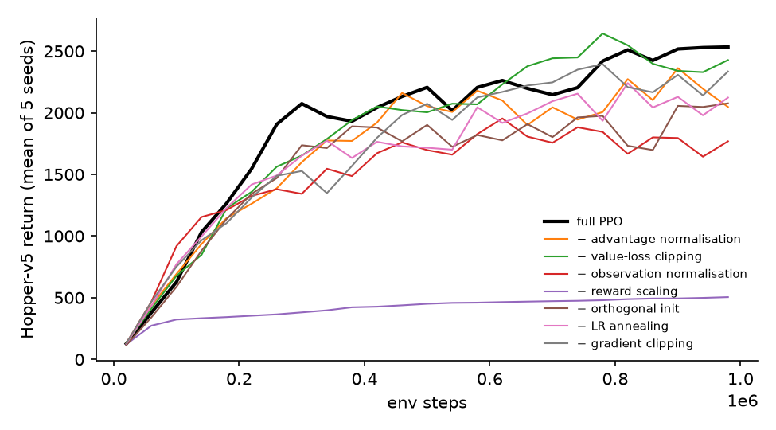
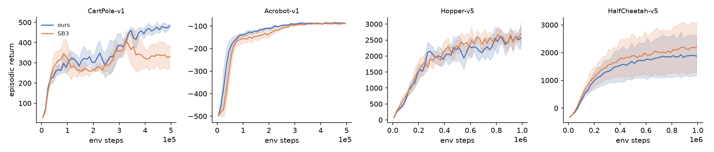
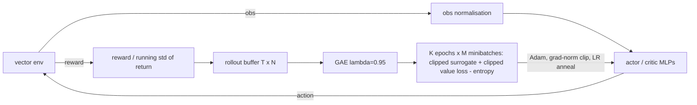

# ppo-details

PPO written from scratch, plus a reproducible measurement of which of its "implementation details" actually matter. Each detail is removed one at a time, with 5 seeds and 95% CIs on classic control and MuJoCo, and the implementation is cross-checked against Stable-Baselines3.

[](https://github.com/eshaan2418/ppo-details/actions/workflows/ci.yml)
[](LICENSE)


## Headline result

Hopper-v5, 1M steps. The metric is the mean episodic return over the last 10% of training, averaged over 5 seeds, ± 95% CI. Δ uses Welch's interval, and p-values are Holm-corrected across the 7 ablations.

| removed detail | final return | Δ vs full PPO | p (Holm) |
|---|---|---|---|
| (none: full PPO) | 2537 ± 363 | - | - |
| reward scaling | **500 ± 30** | **−2037 ± 363** | **0.001** |
| observation normalisation | **1729 ± 399** | **−809 ± 449** | **0.019** |
| orthogonal init | 2048 ± 440 | −490 ± 477 | 0.23 |
| LR annealing | 2078 ± 429 | −460 ± 469 | 0.23 |
| advantage normalisation | 2172 ± 652 | −365 ± 651 | 0.64 |
| gradient clipping | 2259 ± 440 | −278 ± 477 | 0.64 |
| value-loss clipping | 2348 ± 574 | −190 ± 582 | 0.64 |

Two of seven details are clearly necessary on Hopper: scaling rewards by the running std of the return, and normalising observations. The other five have point estimates between −190 and −490, but with 5 seeds their effects cannot be distinguished from zero. On CartPole, no detail matters significantly.



## Correctness check against Stable-Baselines3

Same hyperparameters, network (2×64 tanh, separate actor and critic), and budget. 5 seeds each.

| env | steps | ours | SB3 2.9.2 | Δ (ours − SB3) | p |
|---|---|---|---|---|---|
| CartPole-v1 | 500k | 474.2 ± 19.9 | 334.2 ± 98.3 | +140.0 ± 97.4 | 0.02 |
| Acrobot-v1 | 500k | −86.5 ± 1.8 | −88.9 ± 3.3 | +2.3 ± 3.3 | 0.13 |
| Hopper-v5 | 1M | 2537 ± 363 | 2577 ± 311 | −40 ± 399 | 0.82 |
| HalfCheetah-v5 | 1M | 1884 ± 1151 | 2165 ± 1410 | −281 ± 1522 | 0.68 |



On the MuJoCo tasks and Acrobot the two implementations are statistically indistinguishable. On CartPole, SB3's runs reach ~400 around 300k steps and then regress (curve above), while ours keep improving. I have not isolated the cause. One known difference is a candidate: SB3 bootstraps values at time-limit truncations (`on_policy_algorithm.py`, "Handle timeout by bootstrapping with value function"), while this implementation treats truncation as termination. That changes the value targets near CartPole's 500-step cap.

## Demo

```
$ ppo-details train --env CartPole-v1 --steps 100000
step    9,216  return     43.8  kl 0.0002  clipfrac 0.00  ####
step   36,864  return    182.7  kl 0.0000  clipfrac 0.00  ##################
step   64,512  return    245.7  kl 0.0000  clipfrac 0.00  ########################
step   92,160  return    250.8  kl 0.0000  clipfrac 0.00  #########################
final return (last 10% of training): 203.6 in 2s
```

## Why this exists

PPO's paper describes a clipped objective, but working implementations depend on a dozen extra details (normalisation, initialisation, clipping, schedules) that change results substantially. Practitioners copy them as a bundle, because nobody remembers which ones matter. Published ablations exist, but they are often single-seed, or they report point estimates without uncertainty. This repo measures each detail's marginal effect with enough seeds to attach CIs, corrects for multiple comparisons, and checks the base implementation against a mature library, so the effects are not artefacts of a buggy PPO.

## Highlights

- **About 290 lines of PPO** (`src/ppo_details/ppo.py`): GAE, clipped surrogate, clipped value loss, entropy bonus, running observation normalisation, and reward scaling by return std. All seven details are switchable flags.
- **Verified pieces:** GAE against an explicit per-environment reference recursion (Hypothesis, random episode boundaries), the running mean/variance against NumPy, and the zero gradient outside the clip region. There is also a CartPole learning test in CI.
- **External check:** Stable-Baselines3 with matched hyperparameters on all 4 environments, 5 seeds.
- **Statistics done properly:** 5 seeds, t-intervals, Welch differences (same-seed runs diverge after the first update, so they are not paired), and Holm correction across ablations.
- **100 runs in 1.5 h on a laptop CPU:** 4 parallel single-thread workers, 5.5 CPU-hours in total.

## Quick start

```bash
git clone https://github.com/eshaan2418/ppo-details && cd ppo-details
make setup         # uv venv; gymnasium[mujoco], torch (CPU), stable-baselines3 for the check
make test          # GAE / normalisation / clipping tests + CartPole learning smoke test
make demo          # 100k-step CartPole run with a printed learning curve
make train         # all 100 runs (80 ours + 20 SB3), 4 workers, ~1.5 h on an M5
make plots         # eval/results/tables.md, eval/plots/*.png
```

```bash
.venv/bin/python scripts/run.py --env Hopper-v5 --seed 0 --ablate reward_norm
```

## Method



`L = −E[min(r·Â, clip(r, 0.8, 1.2)·Â)] + 0.5·max((V−R)², (V_old + clip(V−V_old, ±0.2) − R)²) − c_e·H`

Presets are the standard ones (discrete: 8 envs × 128 steps, 4 epochs × 4 minibatches, lr 2.5e-4, entropy 0.01; MuJoCo: 1 env × 2048 steps, 10 epochs × 32 minibatches, lr 3e-4, observation and reward normalisation). They were not tuned. See [docs/DESIGN.md](docs/DESIGN.md).

## Results

Hardware: Apple M5 CPU, single thread per run. Software: Python 3.12.14, PyTorch 2.14.1, Gymnasium 1.4.0, MuJoCo 3.17.0, Stable-Baselines3 2.9.2. Raw per-run JSON (config, every episode's return and length, training diagnostics, commit) is in `eval/results/{runs,sb3}/`. Tables are generated by `scripts/make_tables.py` into [eval/results/tables.md](eval/results/tables.md).

### CartPole-v1 ablations (500k steps, 5 seeds)

| removed detail | final return | Δ vs full PPO | p | mean return over training |
|---|---|---|---|---|
| (none: full PPO) | 474.2 ± 19.9 | - | - | 262.5 ± 7.1 |
| advantage normalisation | 488.8 ± 24.3 | +14.6 ± 26.2 | 0.23 | 276.5 ± 28.7 |
| value-loss clipping | 362.9 ± 142.3 | −111.3 ± 141.6 | 0.10 | 236.5 ± 49.2 |
| orthogonal init | 422.7 ± 109.8 | −51.5 ± 108.9 | 0.27 | 244.8 ± 26.0 |
| LR annealing | 477.5 ± 29.4 | +3.4 ± 30.2 | 0.80 | 279.9 ± 11.5 |
| gradient clipping | 461.8 ± 84.4 | −12.4 ± 83.4 | 0.71 | 289.7 ± 41.8 |

(p-values uncorrected. None reaches significance even before correction. Observation and reward normalisation are off in the discrete preset, so they are not ablated here.)

### Mean return over training (area under the learning curve), Hopper

Reward scaling dominates here too (394 vs 1253). Removing orthogonal init lowers it by 173 ± 112, the only other effect whose CI excludes zero on this measure. Without orthogonal init, learning is slower early even where the final return recovers.

Compute used: 329 CPU-minutes across 100 runs (1.5 h wall clock with 4 workers).

## Error analysis

- **Without reward scaling, Hopper plateaus at ~500.** Hopper's per-step rewards are around 1–3 and episodes last up to 1,000 steps, so raw discounted returns reach the hundreds. The likely mechanism: without scaling, the value loss (weight 0.5) dominates the gradient inside the shared gradient-norm clip, and the critic's large errors make advantages noisy. I did not log the per-term gradient norms to confirm this. All 5 seeds plateau (500 ± 30), so this is a consistent failure, not a few bad seeds.
- **Observation normalisation matters on Hopper, not CartPole.** Hopper observations mix positions and angles with joint velocities on very different scales. Without normalisation, the first tanh layer sees badly scaled inputs. (Mechanism inferred, not measured.)
- **CartPole's clip fraction is ~0.** On CartPole with these hyperparameters the policy moves so little per update that the clip is never active (approx. KL ~1e-4). SB3 measured with the same settings gives the same picture (clip fraction 0.00, KL ~3e-4). Clipping only matters where updates are large. On Hopper the clip fraction is ~0.12 early in training.
- **The seed variance is large.** HalfCheetah final returns range over ±1,150 (95% CI) across 5 seeds for the *same* configuration, which is why most ablation effects on MuJoCo cannot be resolved with 5 seeds. With the observed per-arm standard deviation (~290), detecting a 300-point effect on Hopper at 80% power would need about 15 seeds per arm.

## Design decisions and trade-offs

- **One-at-a-time ablations** measure each detail's marginal value given all the others. They miss interactions (two details may substitute for each other). A full factorial over 7 binary details would be 128 configurations × 5 seeds.
- **Final return as the last 10% of training episodes** (stochastic policy), rather than a separate deterministic evaluation. This matches how the reference implementations report results, needs no evaluation environment with frozen normalisation statistics, and uses ~10% of all episodes, so the estimate is stable.
- **Truncation treated as termination,** as in the reference implementations this one follows. That is a known source of bias, and plausibly the source of the CartPole difference with SB3.
- **CPU only, one thread per run, 4 concurrent runs.** MLPs this small are faster on CPU than on GPU (transfer overhead dominates), so the grid parallelises over runs instead.

## Limitations, risks and ethical considerations

- Four environments and two presets, 5 seeds. Small effects (|Δ| < ~400 on Hopper) are not resolvable at this seed count, and "not significant" here does not mean "does not matter".
- Results are for these hyperparameters. A detail that does not matter at lr 3e-4 may matter at lr 1e-3.
- Simulated control only. No real-world deployment risks. See [MODEL_CARD.md](MODEL_CARD.md) and [DATA_CARD.md](DATA_CARD.md).

## Project structure

```
src/ppo_details/ppo.py   PPO, GAE, normalisers, agent; every detail is a PPOConfig flag
src/ppo_details/cli.py   `ppo-details train`
scripts/run.py           one run (env, seed, ablation)
scripts/sb3_baseline.py  matched Stable-Baselines3 run
scripts/jobs.py, run_all.sh   the 100-run grid, 4 parallel workers
scripts/make_tables.py   tables, Welch CIs, Holm correction, plots
tests/test_ppo.py        GAE reference, running stats, clipping gradient, CartPole learning
```

## Citations

- Schulman, J. et al. *Proximal Policy Optimization Algorithms.* arXiv:1707.06347, 2017.
- Schulman, J. et al. *High-Dimensional Continuous Control Using Generalized Advantage Estimation.* ICLR 2016.
- Engstrom, L. et al. *Implementation Matters in Deep Policy Gradients: A Case Study on PPO and TRPO.* ICLR 2020.
- Andrychowicz, M. et al. *What Matters in On-Policy Reinforcement Learning? A Large-Scale Empirical Study.* ICLR 2021.
- Huang, S. et al. *The 37 Implementation Details of Proximal Policy Optimization.* ICLR Blog Track, 2022.
- Raffin, A. et al. *Stable-Baselines3: Reliable Reinforcement Learning Implementations.* JMLR 22(268), 2021.
- Towers, M. et al. *Gymnasium: A Standard Interface for Reinforcement Learning Environments.* arXiv:2407.17032, 2024.
- Todorov, E., Erez, T. and Tassa, Y. *MuJoCo: A physics engine for model-based control.* IROS 2012.

## License

MIT. See [LICENSE](LICENSE).
